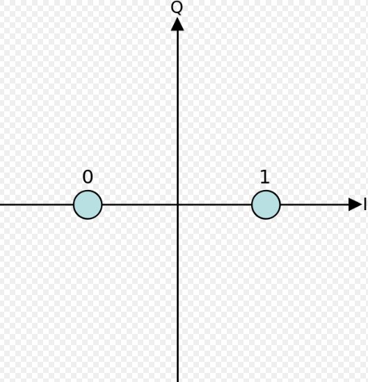
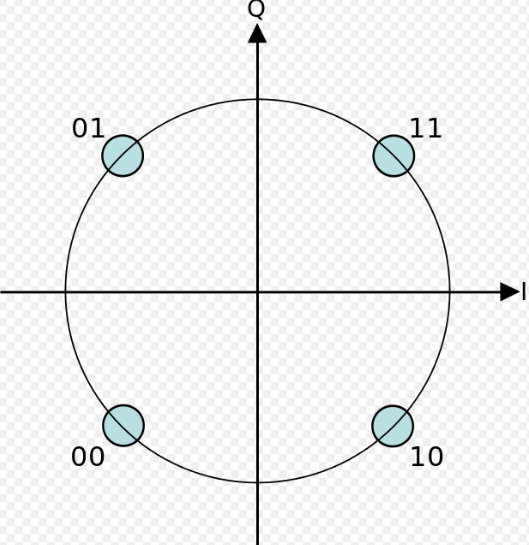
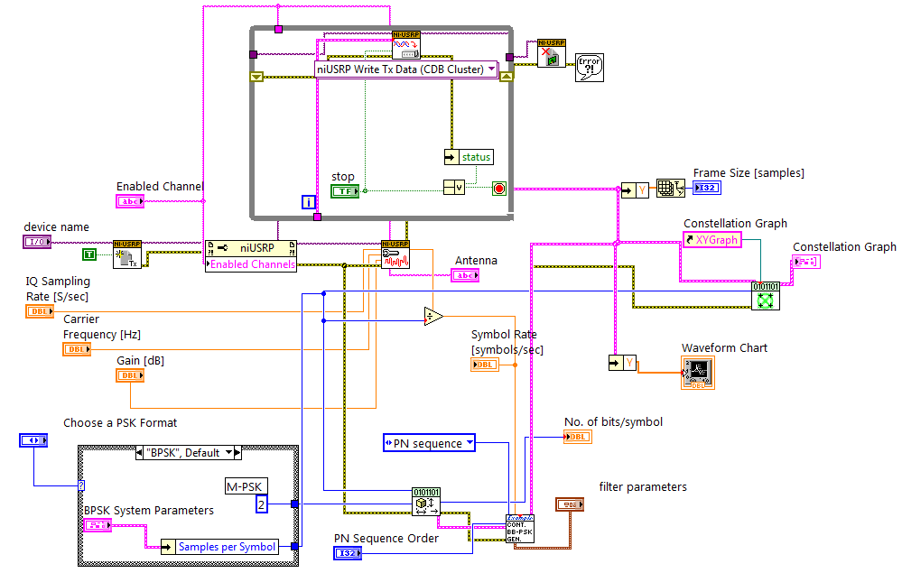
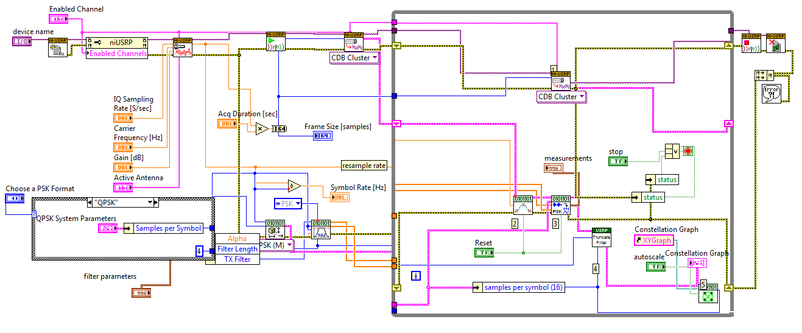

# Implementation of BPSK/QPSK Transmitter and Receiver on NI USRP

It’s our Digital Communication system (DCS) project, in which we have implemented BPSK/QPSK Transmitter and Receiver on NI USRP using LabVIEW.

## Constellations

## Transmitter

.png)

.png)

## Receiver

.png)

.png)

## Files

- [Project abstract (PDF)](ProjectAbstract.pdf)
- [Initial report (PDF)](CourseProject-InitialReport.pdf)
- [Project poster (PDF)](ProjectPoster.pdf) · [as image (JPG)](ProjectPoster.jpg)
- [Steps done at the receiver (JPG)](Steps-done-at-Receiver.jpg)
- [Project presentation (PPTX, on GitHub)](https://github.com/im-Rajat/im-Rajat.github.io/blob/main/College-Projects/BPSK-QPSK/ProjectPresentation.pptx)
- LabVIEW sources: [Transmitter.vi](Transmitter.vi) · [Transmitter-(My).vi](Transmitter-(My).vi) · [Receiver.vi](Receiver.vi)
